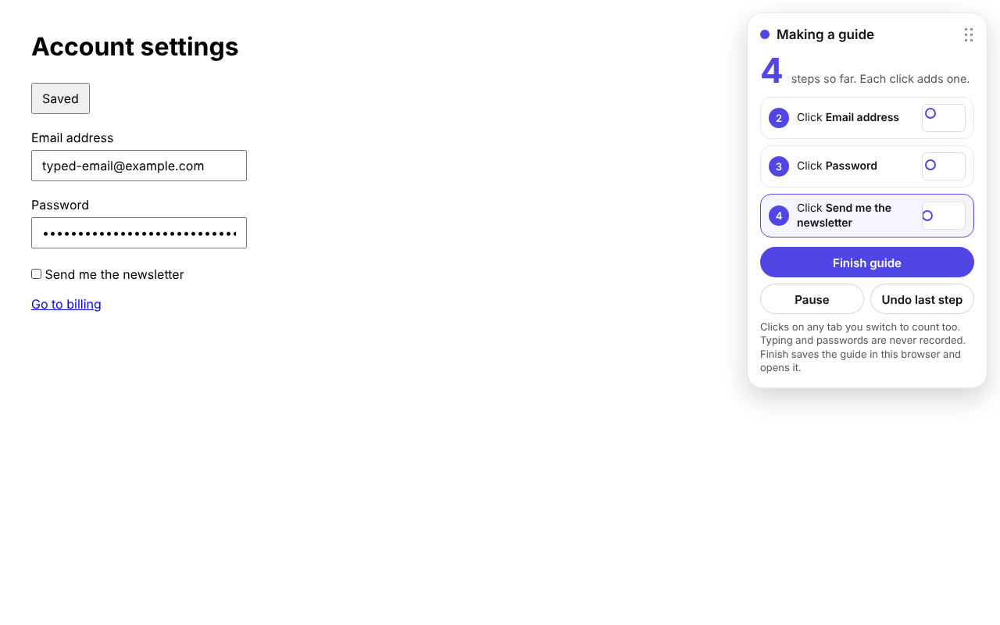
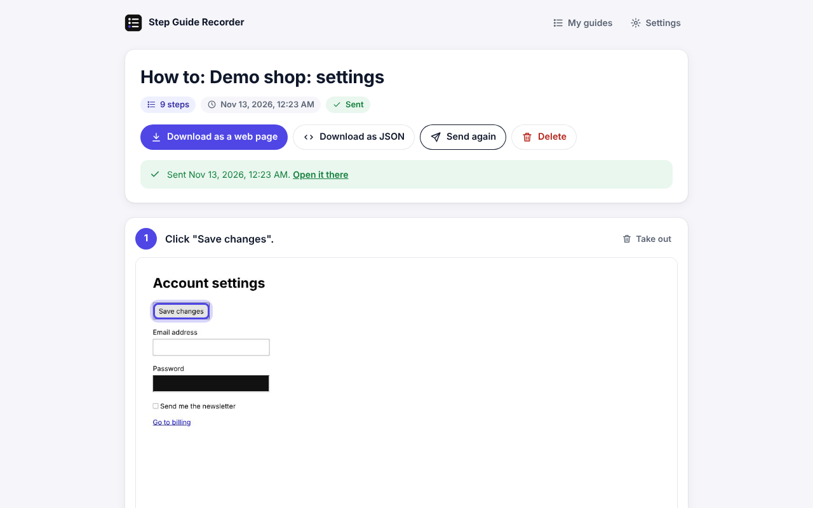
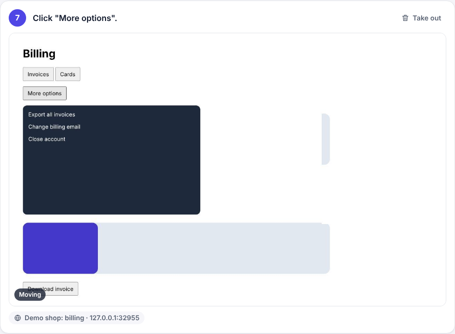
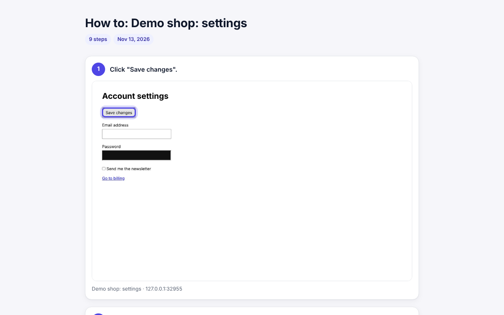
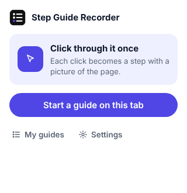
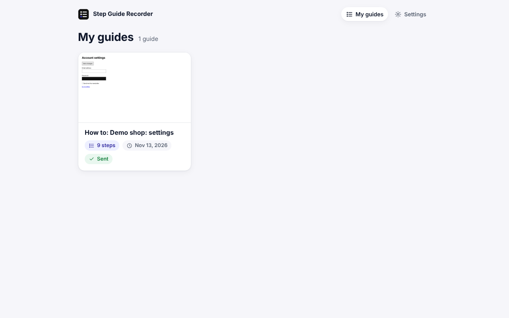
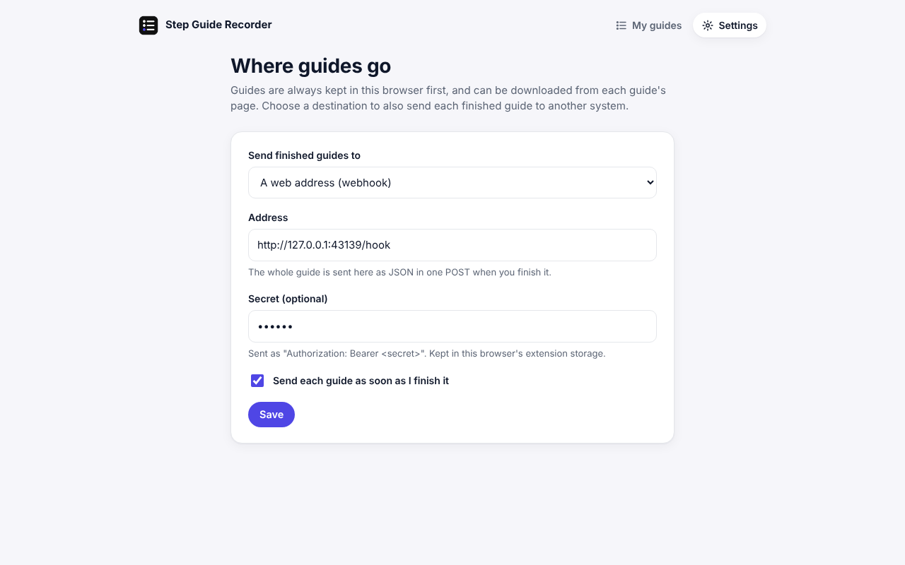

# Step Guide Recorder

A Chrome extension that turns clicking through a task into a step-by-step
guide. Each click becomes a step: a plain sentence ("Click "Save changes".")
and a picture of the page with the clicked thing ringed.

It works on its own, with no account and no server. Guides are kept in your
browser and can be downloaded as a single web page or as JSON. When you want
them to land in another system, you point it at that system in one place
(see [Connecting it to your own system](#connecting-it-to-your-own-system)).

## What a finished guide looks like

All pictures here come from a made-up demo site (`test/site/`).

**While you click**, a panel on the page counts the steps and shows the last three:



**When you finish**, the guide opens in its own page. Every step has one
sentence and a picture with the clicked thing ringed. Click a sentence or the
title to change its words.



**A step that moves plays a short clip.** When a click sets something
moving (a menu opens, the page scrolls, something is dragged), the step keeps
two to three seconds of pictures and plays them, faded one into the next.
Every other step keeps its still picture. Nobody has to choose: the
extension compares the pictures and decides.



**Download as a web page** gives one HTML file with the pictures inside it.
It looks the same and opens anywhere, with no extension and no server:



| The popup | My guides | Settings |
|---|---|---|
|  |  |  |

## What it does

- **Start a guide** from the toolbar icon on the page you want to explain.
- A small panel on the page shows the count and the last steps, with
  **Pause**, **Undo last step** and **Finish guide**. Drag it anywhere.
- **Follows you across tabs** if you allow it on all sites (asked once, at
  the first guide; optional). Without that, press the icon on the new tab and
  the guide carries on there.
- **Finish** opens the guide's page: fix the title or any sentence, take a
  step out, download it, or send it.
- **Moving steps get a clip**, decided by the extension (see below). A drag
  is one step ("Drag "Invoice card".") with a clip of it moving.
- Survives a crash: every step is saved in the browser the moment it is
  taken, and a browser that closes mid-guide keeps what was clicked.

## Privacy

- **Nothing leaves the browser** unless you set up a destination.
- **Typing is never recorded**: no key is listened to and no field's
  contents are read into the guide's text.
- **Password, one-time-code and card fields are painted over** before each
  picture and put back after it.
- **Clips never show typing**: no clip picture is taken while a field or a
  frame has the cursor, or while a password field is anywhere on screen. The
  panel is painted out of every clip picture.
- Page addresses are kept **without their query string or fragment**, which
  often carry tokens and search words.
- **Pictures show what is on screen.** Text already typed into ordinary
  fields, names and other details on the page appear in the pictures. Look
  through a guide before you share it.

## Install (developer mode)

1. Download or clone this repository.
2. Open `chrome://extensions` and turn on **Developer mode** (top right).
3. Press **Load unpacked** and pick the repository folder.
4. Pin the extension, open any web page, press its icon and choose
   **Start a guide on this tab**.

## Connecting it to your own system

Everything that talks to the outside world is in
[`src/destinations.js`](src/destinations.js). Two destinations come with it:

| Destination | What it does |
|---|---|
| `none` (default) | Keeps guides in the browser. Download them from each guide's page. |
| `webhook` | POSTs the whole guide as JSON to an address you choose, with an optional `Authorization: Bearer <secret>` header. If the answer is JSON with a `url`, the guide's page links to it. |

Pick one under **Settings** (from the popup or the guide list). Saving asks
Chrome for permission to reach that address only.

To connect something else (your own API, a storage bucket, a docs tool), add
an entry to `Destinations`:

```js
myApi: {
  label: 'My API',
  fields: [{ key: 'url', label: 'Address', type: 'url' }, { key: 'token', label: 'Key', type: 'password' }],
  origin: function (config) { return new URL(config.url).origin; },   // what Chrome is asked to allow
  send: function (guide, config) {
    // guide is the format below; resolve when your system has it, reject to retry later
    return fetch(config.url, { method: 'POST', headers: { 'X-Key': config.token }, body: JSON.stringify(guide) })
      .then(function (r) { if (!r.ok) throw new Error('Answered ' + r.status); return { url: '' }; });
  }
}
```

It then shows up in Settings. A send that fails is tried again by itself
(after 1, 2, 4 ... minutes, up to 8 tries) and can always be sent again from
the guide's page. The guide stays in the browser either way.

## How a clip is decided

After a step's own picture the extension takes up to five more, one about
every half second (Chrome allows two a second), and stops early at the next
press, Pause, Finish, or a change of tab or page. Before and after each one
it asks the page whether a picture may be taken (see Privacy). Then:

1. Each picture is shrunk to 64 by 40 shades of grey. A cell counts as
   changed when it differs by more than 18 (out of 255).
2. If any later picture differs from the first in at least 3% of cells,
   something moved and the pictures become the step's clip.
3. Pictures at the end that differ from the one before by less than 0.4% are
   dropped, so the clip stops when the movement does.
4. Otherwise the extra pictures are thrown away.

Small movements (a checkbox ticking, a small slider) stay under 3% and keep
a still picture. Change `CLIP_AFTER`, `CLIP_MOVED` and `CLIP_SAME` at the top
of the clip section in `src/background.js` to tune it.

A clip plays at two pictures a second: the first is held twice as long with
the ring on it, the last three times as long, then it starts again. People
whose system asks for less motion see the still picture.

## The guide format

The JSON download and every destination get the same shape
(`format: "step-guide/1"`):

```json
{
  "format": "step-guide/1",
  "id": "gm3k2x9abc123",
  "title": "How to: Account settings",
  "intro": "",
  "createdAt": "2026-01-01T10:00:00.000Z",
  "finishedAt": "2026-01-01T10:02:00.000Z",
  "steps": [
    {
      "n": 1,
      "key": "m3k2xa1b2c3d4",
      "sentence": "Click \"Save changes\".",
      "label": "Save changes",
      "role": "button",
      "page": { "title": "Account settings", "url": "https://example.com/settings" },
      "highlight": { "x": 3.1, "y": 13.25, "w": 10.6, "h": 5 },
      "image": { "type": "image/jpeg", "data": "<base64>" },
      "clip": null
    }
  ]
}
```

`highlight` is the clicked element's box as percentages of the picture, or
`null` when there was nothing to ring. `clip` is `null` for a still step, or
`{ "type": "image/jpeg", "frames": ["<base64>", ...] }` for a step that
moved; `frames[0]` is the same moment as `image`. A system that wants one
animated file can make it from the frames (for example an animated WebP
with ffmpeg).

## How it is built

Plain JavaScript, Manifest V3, no build step.

| File | What it is |
|---|---|
| `manifest.json` | Permissions: `activeTab`, `scripting`, `storage`, `unlimitedStorage`, `alarms`; all sites only as an optional ask. |
| `src/background.js` | Starts, follows and finishes a guide; takes the pictures; sends finished guides. |
| `src/page.js` | Put on the page being explained: names what was clicked, paints over passwords, draws the panel. |
| `src/store.js` | The guides and their pictures, in the extension's IndexedDB. |
| `src/format.js` | Step sentences, titles and the portable format above. |
| `src/destinations.js` | Where finished guides go. The one place to change to connect another system. |
| `src/export.js` | The web page and JSON downloads. |
| `src/clip.js` | Plays a step's clip, on the guide's page and in the downloaded web page. |
| `popup.html`, `library.html`, `guide.html`, `options.html` | The extension's own pages. |
| `src/ui.css` | Their shared look. Change `--accent` to restyle (the panel on the page and the downloaded web page carry the same colour in `page.js` and `export.js`). |
| `src/icons.js` | The line icons the pages use. |

## Test

An end-to-end check runs the real extension in Chromium against a small demo
site: it makes a guide, undoes and pauses, moves between pages, opens a
menu and drags a card (both must get a clip; field, password and still steps
must not), finishes, checks nothing typed was kept, downloads the web page
and sends to a local webhook.

```sh
npm install
npx playwright install chromium
npm test
```

Screenshots land in `test/out/`. Pressing the toolbar icon cannot be
scripted, so the test loads a copy of the extension that is allowed on all
sites and starts the guide the way the popup does.

## Licence

MIT. See [LICENSE](LICENSE).
